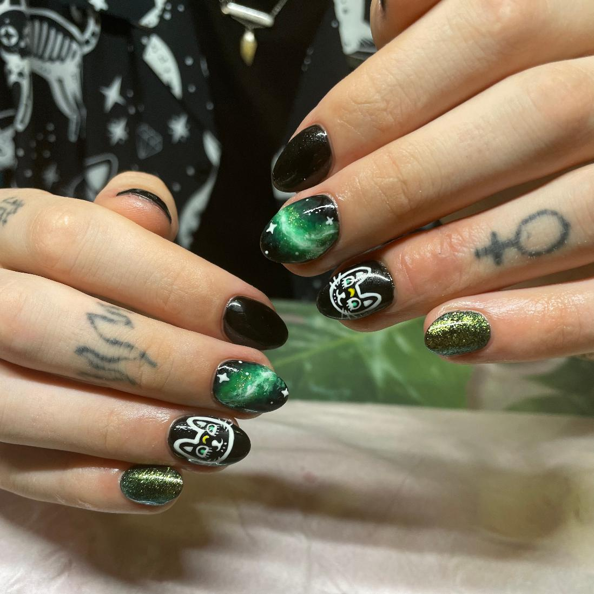

# Aetherium Nails

github repo link:

https://github.com/Bernadett-6/WebDesignAssessment

hosted-page link:


## Website goal

This is a nail appointment booking website for a salon. The user is a client making an appointment or just checking out information about the salon like treatments,location,reviews or prices.

### Table of contents:

- Home page
- Book Now
- Pricelist
- Reviews

## HTML & CSS

I have used semantic HTML tags for my webpage to ensure readability and accessibility.

```
<header>
        <h1>Aetherium Nails</h1>


<nav>

    <a class="bookNowbutton" href="bookNow.html">Book Now</a>


<main>

    <div class="container py-3 gallery">
        <div class="row g-3">


<footer>
    <div class="container-fluid">

```

Throughout the project i have used bootstrap and my own css to style the website. Here im using my own class names ( pricelistPage, itemPrice, etc.) in combination with bootstrap's grid system of containers,rows,columns this way it's easy to organize content and helps make the layout responsive to smaller screens while still being able to add other design choices like a gradient background that I wouldnt be able to achieve with just bootstrap.

```
 <body class="pricelistPage">

    <div class="container">
      <div class="row">

        <div class="col-md-6">
          <div class="px-4 border rounded mx-2 my-5" style="max-width: 700px">
            <h2 class="p-4 priceListheading">Pricelist</h2>

            <div class="mb-5 itemPrice">
              <span>Acrylic</span>
              <span class="dots"></span>
              <span class="price">€60</span>
            </div>
```

```
.formPage,
.pricelistPage {
    background-image: linear-gradient(to top, black, #252B63);
    min-height: 100vh;
}

.itemPrice {
    display: flex;
    align-items: baseline;
    gap: 10px;
    margin-bottom: 15px;
}

.dots {
    flex: 1;
    border-bottom: 2px dotted white;
}

.price {
    white-space: nowrap;
}
```

I am using consistent colors,buttons and font throughout all the pages to make navigation easier to understand.

```

.formPage,
.pricelistPage,
.reviewsPage {
    background-image: linear-gradient(to top, black, #252B63);
    min-height: 100vh;
}

```
```
main {
    background-image: linear-gradient(to top, #252B63, black);
}

```
```

* {
    font-family: Bacasime Antique, sans-serif;

```

I was able to add a small bit of animation to the buttons using transform: scale that im happy with


```

.bookNowbutton:hover,
.priceListbutton:hover,
.reviewsButton:hover,
.formButton:hover {
    background-color: #181C40;
    color: white;
    transform: scale(1.1);
    text-decoration: none;
}

.bookNowbutton:active,
.priceListbutton:active,
.reviewsButton:active,
.formButton:active {
    transform: scale(0.95);
}

```

Here I used bootstrap to make the images appear 2 in a row on a small screen and 3 in a row on a bigger screen. col-6 makes it take up 6 out of the 12 columns, col-md-4 makes it take up 4 out of 12 columns on medium screen and up.

```

<div class="container py-3 gallery">
        <div class="row g-3">

            <div class="col-6 col-md-4">
                
            </div>

            
```
